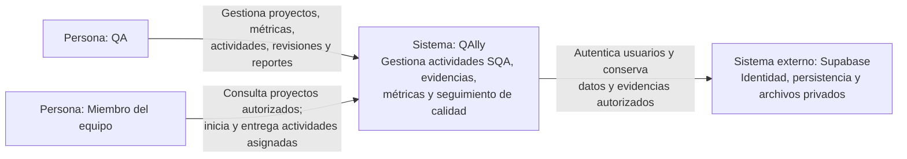

# C4-01 — Contexto de QAlly

**Estado: APROBADO, 2026-10-18.** Diseño documentado tras la aprobación del usuario; no implica implementación. Véase [ADR-001](../decisiones/ADR-001-diseno-tecnico-v1.md).

## Alcance y notación

QAlly gestiona proyectos de software, actividades SQA, evidencias, métricas e indicadores de salud. El diagrama presenta personas y sistemas; omite detalles internos y tecnologías. Cada nodo declara su tipo y cada flecha describe una relación dirigida. Supabase se representa como sistema externo administrado: QAlly define sus datos y políticas, pero no implementa el servicio proveedor.

## Relaciones y límites

| Origen | Destino | Responsabilidad |
|---|---|---|
| QA | QAlly | CU-01, CU-02, CU-03, CU-05 y CU-06, siempre según permisos de proyecto. |
| Miembro del equipo | QAlly | Consulta de CU-01, entrega de CU-04 y consulta de CU-05. Solo inicia y entrega sus actividades asignadas. |
| QAlly | Supabase | Identidad y sesiones, persistencia relacional y PDF privados; se descompone en C2. |

El rol es global y no concede acceso a todos los proyectos. Cada usuario necesita una participación explícita. No hay rol PM dentro de QAlly ni alta autónoma de cuentas en esta versión.

Vercel es el entorno de despliegue; no un sistema funcional adicional. GitHub, GitHub Actions, herramientas de pruebas y editores pertenecen al desarrollo del producto. Las métricas relacionadas con PR o defectos se capturan manualmente. Un enlace de evidencia se registra como referencia; no representa una integración automática con su proveedor. No se requieren correo, OAuth social ni servicios externos de PDF para los CU actuales.

## Fuentes y continuidad

- [C4 oficial: contexto](https://c4model.com/diagrams/system-context).
- [Reglas globales](../producto/reglas-globales.md), [RF](../requisitos/funcionales.md) y [trazabilidad](../requisitos/trazabilidad.md).
- Siguiente nivel: [C4-02 — Contenedores](C4-02-contenedores.md).
