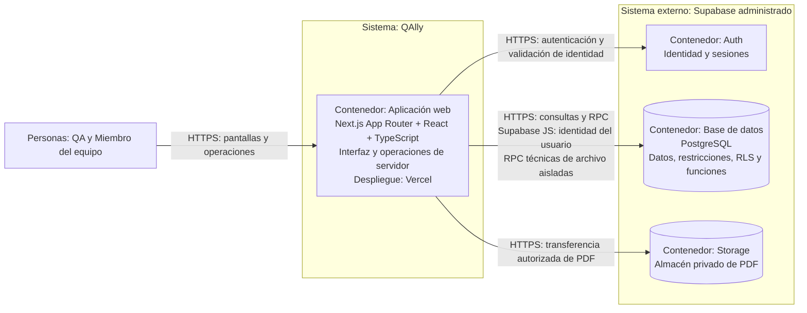

# C4-02 — Contenedores de QAlly

**Estado: APROBADO, 2026-10-18.** Descomposición de [C1](C4-01-contexto.md); mantiene a Supabase como dependencia administrada externa. Un contenedor C4 es una aplicación o un almacén, no necesariamente un contenedor Docker.

## Responsabilidades

| Contenedor | Responsabilidad | Datos y límites |
|---|---|---|
| Aplicación web | Interfaz, validación Zod, autorización, módulos funcionales, consultas y reporte PDF con `@react-pdf/renderer`. | Una unidad de desarrollo y despliegue. React incluye interacción en el navegador; no es una SPA desplegada aparte. |
| Auth | Credenciales, identidad y sesiones. | QAlly referencia `auth.users`; no copia contraseñas ni modifica manualmente el esquema interno de Auth. |
| PostgreSQL | Proyectos, roles, participaciones, catálogos, actividades, entregas, revisiones y mediciones. | Restricciones relacionales, RLS, operaciones transaccionales e índices versionados. |
| Storage | Binarios PDF de evidencia. | Bucket privado; PostgreSQL guarda rutas y metadata, no el binario ni una URL firmada persistente. |

Los tres contenedores de Supabase son abstracciones de los servicios utilizados, no una descripción de todos sus procesos internos. La API de datos y las RPC son interfaces administradas de acceso a PostgreSQL, no un backend QAlly adicional.

## Comunicación y despliegue

- Las operaciones de negocio entran por Next.js. La aplicación valida sesión, rol, proyecto, entrada y estado antes de persistir. Supabase recibe la identidad del usuario para lecturas y RPC normales; las RPC técnicas de archivos reciben actor verificado del servidor por la excepción acotada de ADR-002.
- Una secuencia de llamadas Supabase JS no constituye por sí sola una transacción. Las operaciones compuestas usan una llamada transaccional a PostgreSQL; ver [seguridad e integridad](../datos/seguridad-integridad.md).
- PDF de hasta 3 MiB, una transferencia binaria por petición a un Route Handler de servidor. Sin subida directa del navegador a Storage. El adaptador de archivos aislado usa credencial privilegiada tras autorización expresa y validación, con reserva/confirmación/limpieza acotadas; véase ADR-002 y seguridad/integridad. El resto de operaciones usa identidad del usuario.
- Las lecturas de PDF se autorizan por solicitud. No se publica el bucket ni se distribuyen enlaces permanentes públicos.
- Las sesiones deben validarse en servidor, no solo por presencia de cookies. El mecanismo SSR exacto depende de versiones aún pendientes; [referencia oficial](https://supabase.com/docs/guides/auth/server-side/creating-a-client?queryGroups=framework&framework=nextjs).
- Vercel aloja Next.js; Supabase aloja los servicios administrados. Regiones, planes y configuración de variables siguen pendientes de bootstrap; límites de PDF y reporte ya están definidos. No se incorpora Redis, colas ni otro servicio.

Los secretos de servidor y las claves privilegiadas nunca se envían al navegador. El cliente normal de datos utiliza sesión de usuario, no `service_role` para eludir RLS. Las respuestas privadas y los PDF no deben almacenarse en cachés compartidas sin aislamiento por autorización.

## Fuentes y continuidad

- [C4 oficial: contenedores](https://c4model.com/diagrams/container).
- [Stack aprobado](stack-aprobado.md), [ADR-001](../decisiones/ADR-001-diseno-tecnico-v1.md).
- Siguiente nivel: [C4-03 — Componentes](C4-03-componentes.md).

## Ajustes de ADR-002

No se agregan contenedores ni proveedores. PostgreSQL incorpora `archivo_evidencia`; la captura cifrada del reporte usa `node:crypto` en la aplicación, sin almacén histórico. Las credenciales de archivos y reporte son exclusivamente de servidor; no hay servicio privilegiado separado. [Contratos v1](contratos-v1.md) y [seguridad](../datos/seguridad-integridad.md) definen las excepciones y cotas. La configuración exacta se verificará al implementar.
