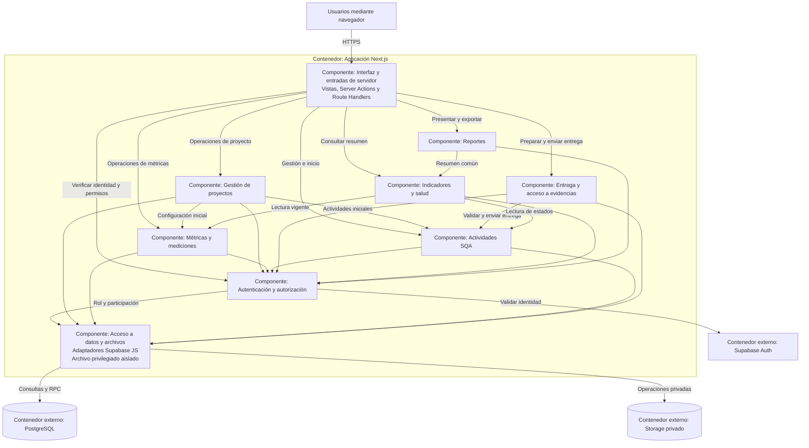

# C4-03 — Componentes de la aplicación Next.js

**Estado: APROBADO, 2026-10-18.** Se abre exclusivamente el contenedor Aplicación web de [C2](C4-02-contenedores.md). Las interfaces conceptuales se concretan en [contratos v1](contratos-v1.md), aprobados por ADR-002; el código TypeScript y SQL ejecutable quedan para implementación.

Las flechas internas sin etiqueta significan «usa funciones internas del componente». Son llamadas dentro del mismo despliegue; no comunicaciones entre servicios.

## Componentes e interfaces

| Componente | Responsabilidad e interfaz conceptual | Dependencias y propiedad |
|---|---|---|
| Interfaz y entradas de servidor | Mostrar vistas; recibir acciones; validar forma de entrada con Zod; devolver errores de validación, acceso, conflicto o persistencia. | Llama a los módulos. Las páginas no implementan fórmulas ni autorización propia divergente. |
| Autenticación y autorización | Obtener identidad verificada; exigir sesión, acceso a proyecto o QA autorizado; comprobar responsable. | Auth y lectura protegida de perfil/participaciones. No confía en autor, rol o proyecto enviados por cliente. |
| Proyectos | Crear configuración completa, consultar, editar datos generales y cerrar. | Es propietario de proyecto y participación; orquesta configuración inicial de métricas/actividades en una sola transacción, no varias escrituras independientes. |
| Métricas y mediciones | Agregar tipo, configurar umbral, registrar medición, agregar corrección y consultar historial/valor vigente/cumplimiento. | Catálogo de métricas, métrica de proyecto y revisiones. Expone lectura reutilizable a salud. |
| Actividades SQA | Crear instancia, asignar, iniciar, enviar a revisión, aprobar y devolver. | Es propietario de la máquina de estados y de la consistencia entrega–revisión–actividad. Expone estados a salud. |
| Entrega y acceso a evidencias | Preparar resultado y evidencia, validar PDF/enlace, coordinar envío, descargar PDF autorizado y compensar cargas fallidas. | Colabora con Actividades; no cambia el estado por su cuenta. Mantiene evidencia por intento y usa Storage privado. |
| Indicadores y salud | Obtener resumen general y por etapa desde lecturas compartidas. | Usa métricas y actividades. Sin algoritmo aprobado devuelve «Sin evaluar» y causas, sin puntaje. |
| Reportes | Generar vista y PDF del mismo resumen, con identificación y fecha. | Usa salud y `@react-pdf/renderer`; exige QA incluso si el resumen es consultable por miembros. |
| Acceso a datos y archivos | Consultas concretas, clientes por contexto autenticado y llamadas transaccionales/Storage. | Supabase JS y tipos generados. Adaptador privilegiado de archivos/limpieza aislado, únicamente después de autorización explícita; el resto usa identidad del usuario. No confía en permisos del cliente. |

## Contratos transversales

- **Contexto autenticado:** identidad verificada en servidor; rol obtenido de perfil protegido; proyecto autorizado. Los módulos vuelven a comprobar lo necesario en cada operación, aunque haya protección de ruta.
- **Escrituras:** entrada validada más estado/versión esperada cuando haya concurrencia; persistencia atómica y error explícito. No se presentan éxitos antes del commit.
- **Resumen de calidad:** proyecto, fecha de lectura, tres etapas, estados de actividades, métricas, revisiones vigentes, objetivos, cumplimiento calculable y causas de ausencia/no evaluación. No incluye una fórmula de salud supuesta.
- **Reporte:** vista y PDF consumen una captura inmutable de ese resumen. Captura autocontenida cifrada/autenticada de 15 minutos; no se acepta como fuente una copia manipulable enviada por el cliente. Si debe regenerarse, se actualiza también la vista y su fecha. No existe tabla de versiones históricas del reporte.

## Componentes, React y carpetas

Un componente C3 agrupa una responsabilidad con interfaces. Una tabla React o un botón son piezas visuales, no nuevos componentes arquitectónicos. `app/`, `features/` y `lib/` son ubicaciones sugeridas, no capas desplegables. Los adaptadores concretos pueden vivir junto a su funcionalidad, compartiendo cliente y utilidades de autorización.

No se requieren interfaces genéricas de repositorio, bus de eventos, CQRS, contenedor de inyección ni una clase por operación. El objetivo es permitir trabajo por módulo sin multiplicar abstracciones.

## Matriz de cobertura

● = responsabilidad o consumo funcional; autorización y acceso a datos son transversales.

| Componente | CU-01 | CU-02 | CU-03 | CU-04 | CU-05 | CU-06 |
|---|:---:|:---:|:---:|:---:|:---:|:---:|
| Proyectos | ● | | | | | |
| Métricas y mediciones | ● | ● | | | ● | ● |
| Actividades SQA | ● | | ● | ● | ● | ● |
| Evidencias | | | ● | ● | | |
| Indicadores y salud | | | | | ● | ● |
| Reportes | | | | | | ● |
| Autorización y acceso a datos | ● | ● | ● | ● | ● | ● |

**Fuentes:** [C4 oficial: componentes](https://c4model.com/diagrams/component), [trazabilidad](../requisitos/trazabilidad.md), [diseño arquitectural](diseno-arquitectural.md).

## Contratos y ajustes aprobados

[ADR-002](../decisiones/ADR-002-cierre-diseno-v1.md) aprueba [contratos v1](contratos-v1.md): DTO/errores/paginación, alta idempotente, objetivos general/crítico, versiones esperadas, revisión de medición esperada, subida PDF individual y exportación con captura. Evidencias es propietario del ciclo de `archivo_evidencia`; Actividades conserva las transiciones. La limpieza es procedimiento administrativo, no un CU ni servicio nuevo. Los módulos de negocio no importan el cliente privilegiado de archivos.
