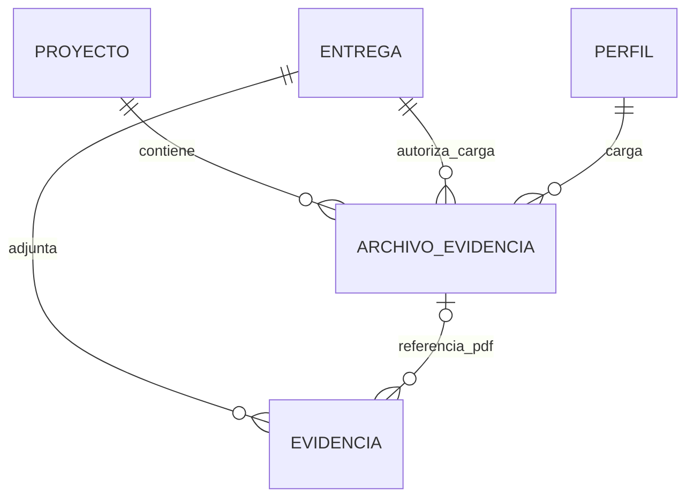

# Detalle técnico de datos v1 — propuesta

> **ANTECEDENTE HISTÓRICO:** propuesta aprobada el 2026-10-18. Su redacción original se conserva abajo; no es un pendiente ni la fuente operativa. Véase [detalle-tecnico-v1.md](detalle-tecnico-v1.md) para la decisión o especificación vigente.

**Estado: PROPUESTO, 2026-10-18.** Complementa el [cierre de diseño](../decisiones/propuesta-cierre-diseno-v1.md). No reemplaza todavía el [diccionario aprobado](diccionario-datos.md) ni contiene SQL ejecutable. Salud permanece pendiente. Las siguientes son decisiones concretas para revisar, no una lista de alternativas sin resolver.

## 1. Tipos y límites físicos

Se mantienen UUID, `date`, `timestamptz` y booleanos del modelo. Fechas técnicas generadas en BD; autores desde contexto verificado. Las fechas de medición conservan zona/instante, sin reinterpretar una corrección como nueva captura. Los textos obligatorios se recortan externamente y no admiten contenido vacío. No se cambia automáticamente la capitalización de nombres ni se eliminan espacios interiores de descripciones.

| Campo o grupo | Definición propuesta |
|---|---|
| Perfil.nombre | `varchar(120)` no vacío. |
| Proyecto.nombre | `varchar(200)` no vacío; no único. |
| Proyecto.descripcion | `varchar(5000)` no vacío. |
| Proyecto.periodo_academico | `varchar(40)` opcional; vacío se normaliza a nulo. |
| Código de etapa/catálogo | `varchar(16)`; único en su catálogo. |
| Nombre de etapa | `varchar(80)`; nombre y orden únicos; orden en 1..3. |
| Nombre de tipo | `varchar(200)` no vacío. |
| Descripción de tipo de actividad | `varchar(5000)` obligatoria; las diez semillas incluyen su alcance de la propuesta. |
| Descripción de instancia | `varchar(5000)` obligatoria; CU-01 copia la descripción del tipo y CU-03 exige descripción específica. |
| Unidad/definición de métrica | `varchar(20)` y `varchar(64)`; `%` para M-01/02/03 y `defectos` para M-04; claves `m01_pruebas_v1`, `m02_pr_v1`, `m03_requisitos_v1`, `m04_defectos_v1`. |
| Resultado de entrega | `varchar(20000)`; nulo en preparación, no vacío al enviar. |
| Observaciones QA | `varchar(10000)`; no vacías al devolver. |
| URL de evidencia | `varchar(2048)`; absoluta HTTP/HTTPS. |
| Fuente de medición | `fuente_referencia` dentro de JSONB, texto no vacío de hasta 2048 caracteres. |
| Causa no evaluable | `varchar(200)`; obligatoria solo cuando el valor principal no es evaluable. |
| Valores/objetivos | `numeric(20,8)`; aritmética decimal en BD. Inputs de objetivo porcentual admiten como máximo cuatro decimales; no redondear silenciosamente entradas inválidas. |
| Conteos JSONB | Enteros [0,1 000 000 000], con claves y relaciones de la propuesta de catálogo. Validación también en RPC. |
| Versiones / orden de registro | `bigint` positivo; orden de medición generado por identidad/secuencia, único y estable. No requiere ausencia de huecos. |
| Revisiones / intentos | `integer` positivo; únicos por medición/actividad. |

Los porcentajes se comparan usando los operandos fuente sin redondeo previo; el valor persistido y presentado es una representación decimal. Los DTO serializan `numeric` y `bigint` como cadenas para evitar pérdida de precisión. Los conteos acotados de entrada pueden ser números enteros JSON.

## 2. Delta respecto al modelo aprobado

### Proyecto

Agregar:

| Campo | Tipo y nulabilidad | Regla |
|---|---|---|
| version | bigint, no nulo, inicial 1 | Aumenta al editar datos generales/cerrar; el cliente aporta versión esperada. No es una versión del resumen de calidad. |
| solicitud_creacion_id | uuid, no nulo | ID estable del formulario; unicidad con `creado_por`. |
| solicitud_creacion_hash | char(64), no nulo | SHA-256 del payload normalizado; solo hexadecimales minúsculos. Calculado exclusivamente por la función de alta en PostgreSQL, nunca recibido como autoridad desde el cliente. |

La repetición del mismo ID por el mismo creador y mismo contenido devuelve el proyecto ya creado, después de comprobar acceso. Mismo ID con distinto contenido devuelve conflicto. La clave permanece mientras exista el proyecto, también tras cierre. El hash cubre datos generales, participantes y selecciones/objetivos iniciales; se ordenan selecciones por ID, se normalizan fechas/decimales y se rechazan claves desconocidas/duplicados no permitidos. La función construye una representación JSONB normalizada y calcula SHA-256 sobre su serialización UTF-8 en BD, evitando dos serializadores independientes de JavaScript y PostgreSQL. No se deduplica por nombre ni periodo.

La función serializa solicitudes iguales con un bloqueo asesor transaccional derivado de creador/solicitud y conserva la restricción única como última defensa. Si dos hashes se disputan la misma clave, solo uno puede confirmar. Una colisión del hash de bloqueo solo provoca espera, nunca identidad compartida: siempre se comprueban UUID y contenido reales.

### Métrica del proyecto

Agregar `objetivo_critico numeric(20,8)` opcional: obligatorio para M-01, nulo para las otras. Objetivos de M-01/02/03 en [0,100]; M-04 entero entre 0 y 2 000 000 000. Retirar `objetivo_superior`, aún no implementado: v1 no usa intervalos. `operador` queda fijo por tipo (`>=` o `<=`); no es editable. La RPC/trigger valida reglas que dependen del catálogo, no un CHECK con consultas a otras tablas.

### Archivo físico y evidencia

Separar archivo de referencia de evidencia. Agregar `archivo_evidencia`; mover desde evidencia la ruta, nombre, MIME y tamaño. Evidencia conserva `id`, `entrega_id`, `tipo`, `autor_id`, `creada_en`, `url`, y agrega `archivo_id` FK opcional. PDF exige archivo y URL nula; Enlace exige URL y archivo nulo.

| Campo de archivo_evidencia | Tipo | Nulo | Regla |
|---|---|:---:|---|
| id | uuid | No | PK generado en servidor; nunca reutilizado. |
| proyecto_id | uuid | No | FK proyecto; inmutable. |
| entrega_origen_id | uuid | No | FK entrega donde se autorizó la carga; mismo proyecto. |
| creado_por | uuid | No | FK perfil, responsable validado al reservar. |
| ruta_objeto | varchar(255) | No | Única; `proyecto_id/archivo_id.pdf` dentro del bucket privado `evidencias`. |
| nombre_archivo | varchar(255) | No | Nombre informativo saneado, sin rutas ni controles. |
| mime_type | varchar(40) | No | `application/pdf`. |
| tamano_bytes | bigint | No | 1..3 145 728. |
| sha256 | char(64) | No | Digest del binario validado; no se deduplica entre proyectos. |
| estado | text | No | Reservado, Disponible, Eliminando o Eliminado. |
| creado_en | timestamptz | No | Fecha de reserva. |
| actualizado_en | timestamptz | No | Última transición/control de referencias. |
| reserva_hasta | timestamptz | No | Creación + 30 minutos; una reserva expirada no se finaliza. |
| sin_referencias_desde | timestamptz | Sí | Fecha desde la cual no tiene referencias; nula si tiene alguna. Mantenida en BD, no por cliente. |

Una referencia solo puede apuntar a un archivo Disponible y del mismo proyecto, dentro de una entrega autorizada. Varias evidencias pueden apuntar al mismo archivo al copiar un intento devuelto. No se concede FK de producto sobre tablas internas de Storage.

## 3. Restricciones concretas

- PK/FK y unicidades del modelo aprobado; borrados históricos restringidos, sin cascada sobre proyectos, perfiles, catálogos usados, mediciones, revisiones o entregas enviadas.
- Proyecto: pareja de cierre ambos nulos o presentes; fin previsto no anterior al inicio; versión positiva; creador/fechas/idempotencia inmutables.
- Participación: PK proyecto/usuario; inserción del QA creador en alta; sin CRUD de permisos posterior en producto.
- Actividad: cuatro estados exactos; responsable nulo solo si Pendiente; FK compuesta proyecto/responsable y comprobación adicional del rol. Prohibir cambiar proyecto/tipo después de creación.
- Entrega: único `(actividad_id, numero_intento)`; único parcial `(actividad_id)` con `enviada_en IS NULL`; envío exige resultado y evidencia válida en la misma transacción. Estado En revisión tiene exactamente un intento vigente enviado y sin revisión; Aprobada tiene revisión Aprobar correspondiente.
- Revisión QA: entrega única, decisión Aprobar/Devolver y observaciones no vacías al devolver; autor QA del proyecto; fila inmutable.
- Evidencia: exclusión PDF/Enlace; entrega editable, pertenencia y archivo Disponible. Toda inserción/eliminación de referencia bloquea el archivo y mantiene `sin_referencias_desde`. Referencias de entregas enviadas no se borran.
- Medición: orden único; identidad/fecha originales inmutables; alta junto a revisión 1. Revisión N+1 exige que la última sea N; sin actualización/borrado directo.
- Valor principal Evaluable exige valor no nulo y causa nula; No evaluable exige valor nulo y causa. La condición crítica de M-01 se deriva aparte y no fuerza a perder un valor general válido.
- Cálculo en función fija por tipo y validación JSONB en BD; ninguna fórmula dinámica. La revisión persistida procede del cálculo confiable, no de `valor` enviado por cliente.

Los mínimos de hijos, transiciones, pertenencia cruzada y numeración consecutiva requieren funciones/controles de integridad, además de CHECK y FK. No se afirma que un CHECK aislado pueda verificarlos.

## 4. Privilegios, RLS y funciones

### Operaciones ordinarias

`anon` y `PUBLIC` sin privilegios de datos ni ejecución de funciones de QAlly. `authenticated` obtiene SELECT con RLS sobre tablas necesarias y EXECUTE únicamente de las RPC funcionales enumeradas en [contratos](../arquitectura/contratos-v1-propuesta.md). Sin INSERT/UPDATE/DELETE directo sobre tablas de negocio. Roles/perfiles y catálogos solo se provisionan por procedimiento administrativo versionado.

Las RPC de escritura serán `SECURITY DEFINER`, con propietario de migración, `search_path` vacío, nombres calificados y sin SQL dinámico. Se revoca EXECUTE predeterminado a PUBLIC y se concede función por función. Cada RPC valida `auth.uid()`, perfil, proyecto, rol, estado, campos y versión; el contexto del servidor no reemplaza estos controles internos. Su acceso privilegiado se limita a las tablas/columnas codificadas en cada función; no se ofrece una RPC genérica de escritura.

Los helpers privados de políticas devuelven solo booleanos sobre la identidad corriente: `tiene_perfil()`, `participa(proyecto_id)`, `es_qa(proyecto_id)` y `es_responsable(actividad_id)`. Helpers de lectura acotados con propietario privilegiado evitan recursión de políticas sobre participación/perfil; nunca aceptan una identidad libre como sustituto de `auth.uid()`.

| Tabla | Predicado SELECT RLS, expresado conceptualmente |
|---|---|
| perfil | Usuario propio o participante de un proyecto compartido con el solicitante. El selector QA se hace por RPC separada, acotada a ID/nombre/rol de cuentas elegibles. |
| proyecto | `participa(id)`. |
| participacion_proyecto | `participa(proyecto_id)`. |
| etapas/tipos | `tiene_perfil()`; catálogo activo para nuevas selecciones, inactivo accesible para entender registros existentes. |
| actividad_sqa / metrica_proyecto / archivo_evidencia | `participa(proyecto_id)`. Campos técnicos de reserva no se exponen en DTO normales. |
| entrega / revision_entrega / evidencia | Resolver su actividad y aplicar participación sobre su proyecto. |
| medicion / revision_medicion | Resolver métrica de proyecto y aplicar participación sobre su proyecto. |

No se crean vistas privilegiadas. El resumen se devuelve desde consulta/RPC que autoriza un proyecto y obtiene todos sus datos bajo una misma captura MVCC.

### Excepción controlada para binarios

**Cambio propuesto respecto al cliente ordinario:** un adaptador exclusivamente de servidor y el procedimiento administrativo de limpieza disponen de credencial privilegiada. Motivo: impedir subidas directas que esquiven validación de bytes y coordinar operaciones Storage/BD. La clave `SUPABASE_SERVICE_ROLE_KEY` no usa prefijo público, no se serializa y no se importa desde UI. No se utiliza para listados, mediciones, revisiones o reportes.

`storage.objects` del bucket privado `evidencias`: SELECT de usuario solo si el archivo está Disponible, tiene una evidencia referenciada y el usuario participa en el proyecto. Sin INSERT/UPDATE/DELETE de clientes autenticados. Las escrituras físicas las hace el adaptador después de autorización expresa. El bucket añade defensa por MIME/tamaño, sin sustituir la validación del servidor.

RPC técnicas `reservar_archivo`, `confirmar_archivo`, `marcar_limpieza`, `confirmar_eliminacion`: EXECUTE solo para el rol de servicio, revocado para `authenticated`, `anon` y PUBLIC. Reserva y confirmación reciben `actor_verificado_id` derivado de Auth por el servidor y repiten sus comprobaciones de rol/participación/responsable/proyecto abierto en BD. Nunca exponer endpoints que acepten ese actor del navegador. La limpieza no suplanta un QA y solo opera sobre objetos elegibles sin referencias.

La credencial privilegiada elude RLS: esta excepción se protege por autorización explícita, funciones acotadas y aislamiento del módulo, y debe revisarse/probarse como tal. No se presenta como una operación protegida automáticamente por RLS.

## 5. Flujo definitivo propuesto de archivo y limpieza

1. Route Handler Node.js recibe un único PDF como cuerpo binario, con ID de entrega en ruta, nombre codificado en cabecera y versión esperada. Verifica sesión y origen; máximo real 3 MiB, contando bytes, sin confiar en Content-Length.
2. Comprueba sufijo `.pdf`, MIME declarado `application/pdf`, cabecera `%PDF-` y marcador final `%%EOF` seguido solo de espacios/saltos de línea. Calcula SHA-256. Esto detecta incompatibilidades básicas; no certifica ausencia de contenido activo ni equivalencia a un análisis antimalware. Descarga como adjunto, sin incrustación automática de PDF en QAlly.
3. `reservar_archivo` comprueba permisos/estado/versión y crea reserva con metadata ya validada. El ID determina la ruta; upsert deshabilitado. La operación de transferencia tiene plazo máximo de 60 segundos, menor que la reserva de 30 minutos.
4. El adaptador sube el binario; `confirmar_archivo` bloquea proyecto, actividad, entrega y archivo, comprueba reserva vigente y versión esperada, marca Disponible e inserta evidencia en un commit. Solo entonces informa éxito. Un proyecto cerrado durante la transferencia impide la confirmación.
5. Si falla, intenta compensación del objeto sin referencias mediante el protocolo de limpieza. Un resultado ambiguo primero consulta reserva/referencias: no borra un archivo que quizá quedó confirmado. Reintenta confirmación con el mismo archivo solo si puede demostrar que el resultado coincide; no duplica evidencia.
6. Una ejecución administrativa diaria procesa hasta 100 candidatos por lote, repitiendo lotes hasta terminar. Reservas expiran a los 30 minutos, pero limpieza ordinaria espera además 24 horas sin referencias. No toca transferencias con lease vigente. Se ejecutará mediante script versionado posterior con credenciales de servidor, sin programador/servicio nuevo obligatorio.
7. Bajo bloqueo del archivo, comprobar cero referencias y margen de 24 horas, marcar Eliminando y confirmar. Nuevas referencias quedan prohibidas por estado. Borrar el objeto vía Storage; un objeto ya ausente cuenta como eliminado. Marcar Eliminado y conservar el registro técnico. Si falla, queda Eliminando para reintento diario, incluso si no cumple nuevamente el margen temporal.

El estado reservado no es una entrega confirmada incompleta: es preparación técnica explícita. Ante fallos permanecen intactos el resultado válido previo y el estado de actividad. No mantener una transacción SQL abierta mientras se transmite el PDF.

## 6. Transacciones y bloqueos elegidos

Mutaciones hijas toman `FOR SHARE` sobre proyecto y comprueban cierre dentro de la transacción; edición/cierre toman `FOR UPDATE` sobre proyecto. Orden uniforme: proyecto → actividad o métrica → entrega o medición → archivos en orden de ID. Las revisiones de medición bloquean su medición `FOR UPDATE`; decisiones QA bloquean actividad/entrega. La limpieza bloquea solo archivos, nunca recorre después hacia proyecto/actividad, para evitar invertir el orden.

El aislamiento READ COMMITTED más bloqueos explícitos y constraints cubre escrituras propuestas; no se requiere SERIALIZABLE global. El resumen se obtiene en una única sentencia con CTE/joins y últimas revisiones, por lo que no mezcla varias lecturas de momentos diferentes. No se bloquean escrituras durante la lectura de reportes.

Alto nivel de idempotencia y concurrencia se concreta en [contratos](../arquitectura/contratos-v1-propuesta.md). Las funciones son la frontera atómica; no se simula una transacción con varias llamadas Supabase JS consecutivas.

## 7. Índices y semillas

Conservar índices aprobados del ER; añadir únicos de idempotencia de proyecto y ruta de archivo; índice `evidencia(archivo_id)` e índice de limpieza sobre estado/fecha sin referencias y expiración. Elegir los últimos tipos de índice con EXPLAIN al implementar; las columnas y casos de acceso ya están definidos.

Semillas de esta propuesta: tres etapas; A-01..A-10 en sus etapas y cinco preselecciones; M-01..M-04 todas en Desarrollo con las claves de definición anteriores. Objetivos son valores iniciales al asociar métricas, editables por QA; no se incrustan umbrales de salud en semillas.

Dataset de aceptación previsto, generado solo al implementar: dos QA y cuatro miembros sin acceso cruzado; un proyecto abierto grande con 1000 actividades, cuatro métricas y 1000 mediciones de cada una, un proyecto abierto pequeño y uno cerrado. Incluir actividades repetidas, devoluciones, entregas con PDF/enlace, mediciones corregidas, denominadores cero y ceros evaluables. Diez ejecuciones por vista/operación; casos de fallos separados. No se han creado estos usuarios/datos ni se asegura rendimiento por anticipado.

## 8. Fuentes técnicas

[Funciones Supabase](https://supabase.com/docs/guides/database/functions), [RLS](https://supabase.com/docs/guides/database/postgres/row-level-security), [Storage](https://supabase.com/docs/guides/storage/security/access-control), [bloqueos PostgreSQL](https://www.postgresql.org/docs/current/explicit-locking.html). Las tablas, límites y políticas propuestas son decisiones propias de QAlly; deben incorporarse a la documentación canónica solo al aprobarse.
