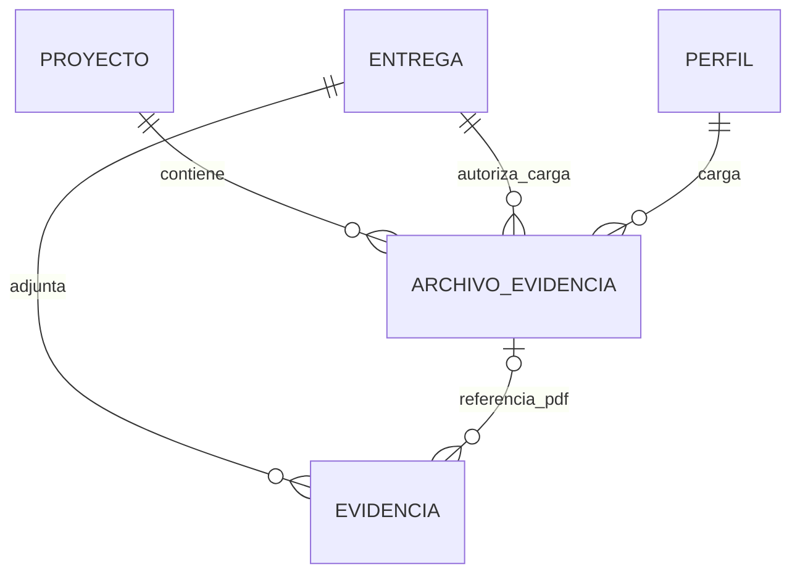

# Detalle técnico de datos v1

**Estado: APROBADO, 2026-10-18**, por [ADR-002](../decisiones/ADR-002-cierre-diseno-v1.md). Especifica tipos, restricciones y realización del modelo; no contiene SQL ejecutable. [Diccionario](diccionario-datos.md), [ER](modelo-entidad-relacion.md) y [seguridad e integridad](seguridad-integridad.md) son fuentes complementarias. Salud sigue pendiente.

## 1. Tipos y límites físicos

Se mantienen UUID, `date`, `timestamptz` y booleanos del modelo. Fechas técnicas generadas en BD; autores desde contexto verificado. Las fechas de medición conservan zona/instante, sin reinterpretar una corrección como nueva captura. Los textos obligatorios se recortan externamente y no admiten contenido vacío. No se cambia automáticamente la capitalización de nombres ni se eliminan espacios interiores de descripciones.

| Campo o grupo | Definición aprobada |
|---|---|
| Perfil.nombre | `varchar(120)` no vacío. |
| Proyecto.nombre | `varchar(200)` no vacío; no único. |
| Proyecto.descripcion | `varchar(5000)` no vacío. |
| Proyecto.periodo_academico | `varchar(40)` opcional; vacío se normaliza a nulo. |
| Código de etapa/catálogo | `varchar(16)`; único en su catálogo. |
| Nombre de etapa | `varchar(80)`; nombre y orden únicos; orden en 1..3. |
| Nombre de tipo | `varchar(200)` no vacío. |
| Descripción de tipo de actividad | `varchar(5000)` obligatoria; las diez semillas incluyen el alcance del catálogo aprobado. |
| Descripción de instancia | `varchar(5000)` obligatoria; CU-01 copia la descripción del tipo y CU-03 exige descripción específica. |
| Unidad/definición de métrica | `varchar(20)` y `varchar(64)`; `%` para M-01/02/03 y `defectos` para M-04; claves `m01_pruebas_v1`, `m02_pr_v1`, `m03_requisitos_v1`, `m04_defectos_v1`. |
| Resultado de entrega | `varchar(20000)`; nulo en preparación, no vacío al enviar. |
| Observaciones QA | `varchar(10000)`; no vacías al devolver. |
| URL de evidencia | `varchar(2048)`; absoluta HTTP/HTTPS. |
| Fuente de medición | `fuente_referencia` dentro de JSONB, texto no vacío de hasta 2048 caracteres. |
| Causa no evaluable | `varchar(200)`; obligatoria solo cuando el valor principal no es evaluable. |
| Valores/objetivos | `numeric(20,8)`; aritmética decimal en BD. Inputs de objetivo porcentual admiten como máximo cuatro decimales; no redondear silenciosamente entradas inválidas. |
| Conteos JSONB | Enteros [0,1 000 000 000], con claves y relaciones del catálogo aprobado. Validación también en RPC. |
| Versiones / orden de registro | `bigint` positivo; orden de medición generado por identidad/secuencia, único y estable. No requiere ausencia de huecos. |
| Revisiones / intentos | `integer` positivo; únicos por medición/actividad. |

Los porcentajes se comparan usando los operandos fuente sin redondeo previo; el valor persistido y presentado es una representación decimal. Los DTO serializan `numeric` y `bigint` como cadenas para evitar pérdida de precisión. Los conteos acotados de entrada pueden ser números enteros JSON.

## 2. Ajustes aprobados sobre ADR-001

### Proyecto

Columnas incorporadas al diseño:

| Campo | Tipo y nulabilidad | Regla |
|---|---|---|
| version | bigint, no nulo, inicial 1 | Aumenta al editar datos generales/cerrar; el cliente aporta versión esperada. No es una versión del resumen de calidad. |
| solicitud_creacion_id | uuid, no nulo | ID estable del formulario; unicidad con `creado_por`. |
| solicitud_creacion_hash | char(64), no nulo | SHA-256 del payload normalizado; solo hexadecimales minúsculos. Calculado exclusivamente por la función de alta en PostgreSQL, nunca recibido como autoridad desde el cliente. |

La repetición del mismo ID por el mismo creador y mismo contenido devuelve el proyecto ya creado, después de comprobar acceso. Mismo ID con distinto contenido devuelve conflicto. La clave permanece mientras exista el proyecto, también tras cierre. El hash cubre datos generales, participantes y selecciones/objetivos iniciales; se ordenan selecciones por ID, se normalizan fechas/decimales y se rechazan claves desconocidas/duplicados no permitidos. La función construye una representación JSONB normalizada y calcula SHA-256 sobre su serialización UTF-8 en BD, evitando dos serializadores independientes de JavaScript y PostgreSQL. No se deduplica por nombre ni periodo.

La función serializa solicitudes iguales con un bloqueo asesor transaccional derivado de creador/solicitud y conserva la restricción única como última defensa. Si dos hashes se disputan la misma clave, solo uno puede confirmar. Una colisión del hash de bloqueo solo provoca espera, nunca identidad compartida: siempre se comprueban UUID y contenido reales.

### Métrica del proyecto

Se incorpora `objetivo_critico numeric(20,8)` opcional: obligatorio para M-01, nulo para las otras. Objetivos de M-01/02/03 en [0,100]; M-04 entero entre 0 y 2 000 000 000. Se retira del diseño `objetivo_superior`, nunca implementado: v1 no usa intervalos. `operador` queda fijo por tipo (`>=` o `<=`); no es editable. La RPC/trigger valida reglas que dependen del catálogo, no un CHECK con consultas a otras tablas.

### Archivo físico y evidencia

Se separa el archivo físico de la referencia de evidencia. Se incorpora `archivo_evidencia`, que recibe la ruta, nombre, MIME y tamaño antes definidos en evidencia. Evidencia conserva `id`, `entrega_id`, `tipo`, `autor_id`, `creada_en`, `url`, y agrega `archivo_id` FK opcional. PDF exige archivo y URL nula; Enlace exige URL y archivo nulo.

| Campo de archivo_evidencia | Tipo | Nulo | Regla |
|---|---|:---:|---|
| id | uuid | No | PK generado en servidor; nunca reutilizado. |
| proyecto_id | uuid | No | FK proyecto; inmutable. |
| entrega_origen_id | uuid | No | FK entrega donde se autorizó la carga; mismo proyecto. |
| creado_por | uuid | No | FK perfil, responsable validado al reservar. |
| ruta_objeto | varchar(255) | No | Única; `proyecto_id/archivo_id.pdf` dentro del bucket privado `evidencias`. |
| nombre_archivo | varchar(255) | No | Nombre informativo saneado, sin rutas ni controles. |
| mime_type | varchar(40) | No | `application/pdf`. |
| tamano_bytes | bigint | No | 1..3 145 728. |
| sha256 | char(64) | No | Digest del binario validado; no se deduplica entre proyectos. |
| estado | text | No | Reservado, Disponible, Eliminando o Eliminado. |
| creado_en | timestamptz | No | Fecha de reserva. |
| actualizado_en | timestamptz | No | Última transición/control de referencias. |
| reserva_hasta | timestamptz | No | Creación + 30 minutos; una reserva expirada no se finaliza. |
| sin_referencias_desde | timestamptz | Sí | Fecha desde la cual no tiene referencias; nula si tiene alguna. Mantenida en BD, no por cliente. |

Una referencia solo puede apuntar a un archivo Disponible y del mismo proyecto, dentro de una entrega autorizada. Varias evidencias pueden apuntar al mismo archivo al copiar un intento devuelto. No se concede FK de producto sobre tablas internas de Storage.

## 3. Restricciones concretas

- PK/FK y unicidades del modelo ER; borrados históricos restringidos, sin cascada sobre proyectos, perfiles, catálogos usados, mediciones, revisiones o entregas enviadas.
- Proyecto: pareja de cierre ambos nulos o presentes; fin previsto no anterior al inicio; versión positiva; creador/fechas/idempotencia inmutables.
- Participación: PK proyecto/usuario; inserción del QA creador en alta; sin CRUD de permisos posterior en producto.
- Actividad: cuatro estados exactos; responsable nulo solo si Pendiente; FK compuesta proyecto/responsable y comprobación adicional del rol. Prohibir cambiar proyecto/tipo después de creación.
- Entrega: único `(actividad_id, numero_intento)`; único parcial `(actividad_id)` con `enviada_en IS NULL`; envío exige resultado y evidencia válida en la misma transacción. Estado En revisión tiene exactamente un intento vigente enviado y sin revisión; Aprobada tiene revisión Aprobar correspondiente.
- Revisión QA: entrega única, decisión Aprobar/Devolver y observaciones no vacías al devolver; autor QA del proyecto; fila inmutable.
- Evidencia: exclusión PDF/Enlace; entrega editable, pertenencia y archivo Disponible. Toda inserción/eliminación de referencia bloquea el archivo y mantiene `sin_referencias_desde`. Referencias de entregas enviadas no se borran.
- Medición: orden único; identidad/fecha originales inmutables; alta junto a revisión 1. Revisión N+1 exige que la última sea N; sin actualización/borrado directo.
- Valor principal Evaluable exige valor no nulo y causa nula; No evaluable exige valor nulo y causa. La condición crítica de M-01 se deriva aparte y no fuerza a perder un valor general válido.
- Cálculo en función fija por tipo y validación JSONB en BD; ninguna fórmula dinámica. La revisión persistida procede del cálculo confiable, no de `valor` enviado por cliente.

Los mínimos de hijos, transiciones, pertenencia cruzada y numeración consecutiva requieren funciones/controles de integridad, además de CHECK y FK. No se afirma que un CHECK aislado pueda verificarlos.

## 4. Políticas, transacciones y archivos

Los privilegios, RPC definidoras, RLS, adaptador privilegiado de archivos, protocolo de reservas, limpieza y bloqueos están especificados en [seguridad e integridad](seguridad-integridad.md). Las interfaces están en [contratos v1](../arquitectura/contratos-v1.md). No se elige entre alternativas durante la implementación: cualquier cambio de estos acuerdos requiere revisión.

## 5. Índices y semillas

Conservar índices aprobados del ER; añadir únicos de idempotencia de proyecto y ruta de archivo; índice `evidencia(archivo_id)` e índice de limpieza sobre estado/fecha sin referencias y expiración. Elegir los últimos tipos de índice con EXPLAIN al implementar; las columnas y casos de acceso ya están definidos.

Semillas aprobadas: tres etapas; A-01..A-10 en sus etapas y cinco preselecciones; M-01..M-04 todas en Desarrollo con las claves de definición anteriores. Objetivos son valores iniciales al asociar métricas, editables por QA; no se incrustan umbrales de salud en semillas.

Dataset de aceptación generado por los scripts locales del bootstrap; ver [guía Supabase](guia-supabase.md) para semillas y dataset grande opcional: dos QA y cuatro miembros sin acceso cruzado; un proyecto abierto grande con 1000 actividades, cuatro métricas y 1000 mediciones de cada una, un proyecto abierto pequeño y uno cerrado. Incluir actividades repetidas, devoluciones, entregas con PDF/enlace, mediciones corregidas, denominadores cero y ceros evaluables. Diez ejecuciones por vista/operación; casos de fallos separados. Los usuarios/datos se crean solo localmente mediante los scripts autorizados; su existencia no certifica rendimiento. Las diez mediciones por operación en entorno desplegado siguen pendientes.

## 6. Fuentes técnicas

[Funciones Supabase](https://supabase.com/docs/guides/database/functions), [RLS](https://supabase.com/docs/guides/database/postgres/row-level-security), [Storage](https://supabase.com/docs/guides/storage/security/access-control), [bloqueos PostgreSQL](https://www.postgresql.org/docs/current/explicit-locking.html). Las tablas, límites y controles aprobados están implementados mediante migraciones versionadas y cuentan con pruebas locales de BD. CU-01 los reutiliza sin cambios de esquema; [alcance y resultados de aplicación](../modulos/cu01-implementacion.md). La validación de los demás flujos de aplicación sigue pendiente.
