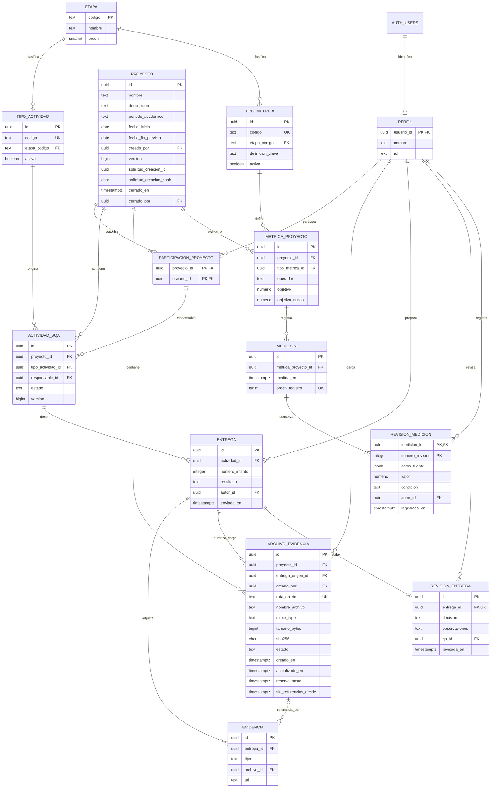

# Modelo entidad-relación de QAlly

**Estado: diseño APROBADO, 2026-10-18.** Catálogos v1 y ajustes de esquema aprobados por [ADR-002](../decisiones/ADR-002-cierre-diseno-v1.md). Solo algoritmo/clasificación de salud siguen pendientes de producto. No es una migración ejecutable. Fuentes: [invariantes](invariantes-de-modelado.md), [diccionario](diccionario-datos.md), [seguridad e integridad](seguridad-integridad.md) y [ADR-001](../decisiones/ADR-001-diseno-tecnico-v1.md).

## Diagrama

PK = primaria; FK = foránea; UK = única. Las unicidades compuestas y las autorías adicionales están en el diccionario. `AUTH_USERS` representa la tabla administrada `auth.users`, no una tabla nueva de QAlly. Puede existir identidad sin perfil, pero no operar en el producto hasta estar provisionada.

## Identidad, proyecto y etapas

- Cada perfil tiene un único rol global: QA o Miembro del equipo. La participación no contiene un segundo rol. Se descarta por ahora variar el rol por proyecto.
- La relación perfil–proyecto es muchos a muchos. Cada proyecto incluye al QA creador en sus participaciones, dentro de la transacción inicial. Ser creador o tener rol QA no sustituye la pertenencia al consultar un proyecto.
- Nombre, descripción y fecha de inicio son obligatorios. Periodo académico y fin previsto son opcionales. No hay unicidad por periodo ni por nombre. Fin previsto, si existe, no precede al inicio.
- El cierre se representa por autor y fecha, ambos nulos o ambos presentes. No se duplica un estado abierto/cerrado derivable. Tras cierre se rechazan todas las escrituras de negocio; la consulta y los reportes siguen permitidos según rol.
- Las tres etapas son datos fijos. Cada tipo de catálogo referencia una etapa; cada instancia hereda esa clasificación. No se agrega una etapa libre por actividad o métrica.

## Catálogos e instancias

- Un tipo de actividad genera cero o muchas instancias incluso dentro del mismo proyecto. No existe unicidad `(proyecto, tipo_actividad)`.
- Un tipo de métrica se configura como máximo una vez por proyecto: unicidad `(proyecto_id, tipo_metrica_id)`.
- Los códigos de catálogo son estables. Los elementos retirados se desactivan para nuevas selecciones, conservando sus referencias históricas. No hay CRUD de catálogos para usuarios.
- La preselección de actividades es una propiedad del catálogo; el usuario puede desmarcarla. Preseleccionadas A-01, A-03, A-05, A-06 y A-09; ver catálogo aprobado.
- No se permite modificar silenciosamente la etapa o el significado de un tipo ya utilizado. La decisión sobre migración de datos o nueva versión de definición debe revisarse antes de ese cambio. No se impone una infraestructura genérica de versionado de catálogos.

## Actividad, entrega y revisión

La actividad puede no tener responsable mientras está Pendiente. La FK compuesta `(proyecto_id, responsable_id)` referencia `participacion_proyecto`; además se valida el rol Miembro del equipo. Un responsable puede tener muchas actividades. Asignar solo se permite en Pendiente y no inicia la actividad.

Cada intento tiene una entrega. `enviada_en` nulo significa preparación; se permite resultado parcial y cero evidencias. Hay como máximo un intento en preparación por actividad. Al enviar se exige resultado no vacío y al menos una evidencia válida; se fija fecha de envío y el conjunto queda inmutable. No hay un estado de entrega separado que duplique el de la actividad.

QA revisa la entrega enviada vigente, una única vez por intento. La revisión decide aprobar o devolver, con observaciones obligatorias en devolución. Una devolución mantiene intacto lo revisado y permite preparar un nuevo intento copiando el resultado y referencias previas. Reutilizar un PDF significa crear una referencia al mismo objeto inmutable, no sobrescribirlo; solo se elimina físicamente si no hay referencias ni usos pendientes protegidos.

La cardinalidad entrega–evidencia es 0..N para permitir preparación; el mínimo de una al enviar se comprueba transaccionalmente. La cardinalidad actividad–entrega es 0..N; actividad recién creada todavía no tiene entrega.

La aprobación queda registrada por `revision_entrega.qa_id` y `revisada_en`. No se duplican esos campos en actividad. Las transiciones están definidas en [seguridad e integridad](seguridad-integridad.md).

## Archivo físico, idempotencia y precisión

`archivo_evidencia` conserva un objeto físico; `evidencia` es su referencia desde una entrega o un enlace alternativo. PDF requiere archivo Disponible y del mismo proyecto; Enlace requiere URL y archivo nulo. Un archivo admite cero o muchas referencias y nunca se sobrescribe; Reservado, Disponible, Eliminando y Eliminado son estados técnicos, distintos de la actividad SQA. Referencias enviadas se conservan. Se bloquea al confirmar/quitar referencias o marcar limpieza; ver [detalle técnico](detalle-tecnico-v1.md).

Proyecto incorpora `version`, `solicitud_creacion_id` y `solicitud_creacion_hash`. La unicidad de creador/solicitud y el hash normalizado permiten recuperar un alta confirmada sin duplicar proyecto, participantes ni configuración. La versión controla edición/cierre, no versiona el resumen de salud. Periodo informativo admite múltiples proyectos.

Nombre y descripción obligatorios en tipo/instancia; CU-01 copia la descripción de catálogo, CU-03 especifica el alcance. Tipos/longitudes están en el diccionario y el detalle técnico; valores y objetivos usan numeric(20,8), comparaciones de tasas con operandos exactos.

## Mediciones y correcciones

La identidad de medición contiene fecha de medición y orden estable; la revisión 1 contiene la captura original. Toda corrección agrega revisión N+1 con datos fuente completos, valor/evaluabilidad, autor y fecha. La anterior es N: una consulta de historial reconstruye anterior y nuevo sin sobrescribir registros.

Se obtiene la medición vigente por `medida_en DESC, orden_registro DESC`; luego su revisión de mayor número. La fecha de medición y el orden no cambian al corregir. Una corrección antigua nunca desplaza una medición más reciente. Corregir fechas de identidad no forma parte de la operación aprobada.

No se almacena un segundo «valor actual» en la métrica del proyecto. Si no hay medición se devuelve «Sin medición». Si existe pero no puede calcularse, se conserva la fuente y `valor` nulo con causa no evaluable. Un cero real solo proviene de una medición explícita evaluable. El cumplimiento se deriva del valor y el objetivo actual, no de una clasificación de salud.

Los campos variables de origen se concentran en `datos_fuente` JSONB validado por definición; el resto mantiene relaciones y tipos PostgreSQL. No se ejecutan fórmulas enviadas por clientes. Capturas, restricciones y fórmulas de M-01..M-04 definidas en el [catálogo aprobado](../producto/catalogo-metricas.md), todas en Desarrollo. Operador fijo por tipo; M-01 tiene objetivo general y crítico. No hay intervalos ni `objetivo_superior`.

## Salud, reportes e índices

No se crean tablas de puntajes, pesos, categorías definitivas de salud ni historial de PDF. Los datos de entrada se consultan desde actividades, sus tipos/etapas, métricas, objetivos y mediciones corregidas. Una consulta debe incluir las tres etapas incluso si no hay registros asociados.

Índices previstos, además de PK y unicidades:

| Acceso | Índice previsto |
|---|---|
| Proyectos de un usuario y filtro RLS | Participación `(usuario_id, proyecto_id)`; la PK cubre el recorrido inverso. |
| Actividades por proyecto/estado | Actividad `(proyecto_id, estado)`. |
| Actividades asignadas | Actividad `(responsable_id, proyecto_id, estado)`. |
| Tipos/etapas y FKs | Índices sobre FKs de catálogo usadas en joins; confirmar necesidad con consultas reales. |
| Intentos | Entrega única `(actividad_id, numero_intento)` y única parcial por actividad con envío nulo. |
| Evidencias y archivos | Evidencia `(entrega_id)` y `(archivo_id)`; archivo con ruta única y FK al proyecto/entrega de origen. |
| Idempotencia de alta | Proyecto único `(creado_por, solicitud_creacion_id)` y hash de payload en BD. |
| Limpieza de archivos | Archivo por estado, sin_referencias_desde y reserva_hasta; candidatos sin referencias. |
| Última medición | Medición `(metrica_proyecto_id, medida_en DESC, orden_registro DESC)`. |
| Revisiones | La PK `(medicion_id, numero_revision)` permite buscar la última revisión. |

Paginación para listas/historial y consultas agrupadas para resúmenes; evitar consultas por cada fila. Los índices físicos finales se comprobarán con planes y dataset representativo, sin afirmar tiempos de RNF todavía.
