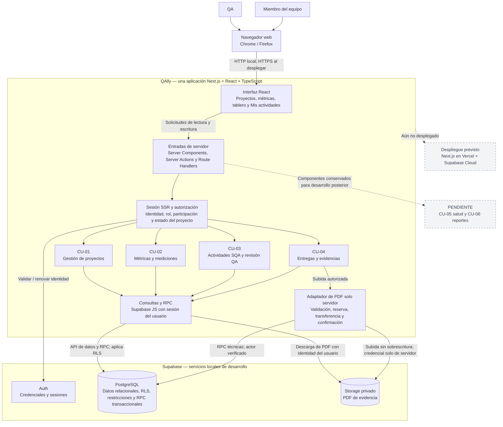

# Arquitectura general de QAlly

Vista de la implementación actual. Next.js agrupa interfaz y operaciones de servidor en un monolito modular. Supabase local aporta identidad, datos y archivos privados; Vercel y Supabase Cloud son destinos aprobados todavía sin configurar.

Las flechas internas representan llamadas dentro de la aplicación. La selección inicial de métricas y actividades de CU-01 se confirma mediante una única RPC de alta, sin desplegar módulos como servicios independientes. La autorización de cada acción/handler complementa RLS; ocultar controles no concede ni restringe por sí solo el acceso.

La descarga pasa por Next.js y usa la sesión ordinaria; la subida usa el adaptador privilegiado después de verificar permisos y contenido. Las claves privilegiadas no llegan al navegador. Un enlace de evidencia se guarda como URL validada, sin descargar su destino. La transferencia de un PDF y su confirmación en BD son pasos distintos, con reserva y compensación, no una transacción que abarque la red.

Fuentes: [C2](../arquitectura/C4-02-contenedores.md), [C3](../arquitectura/C4-03-componentes.md) y [guía de integración](../equipo/integracion-cu02-cu03-cu04.md).
