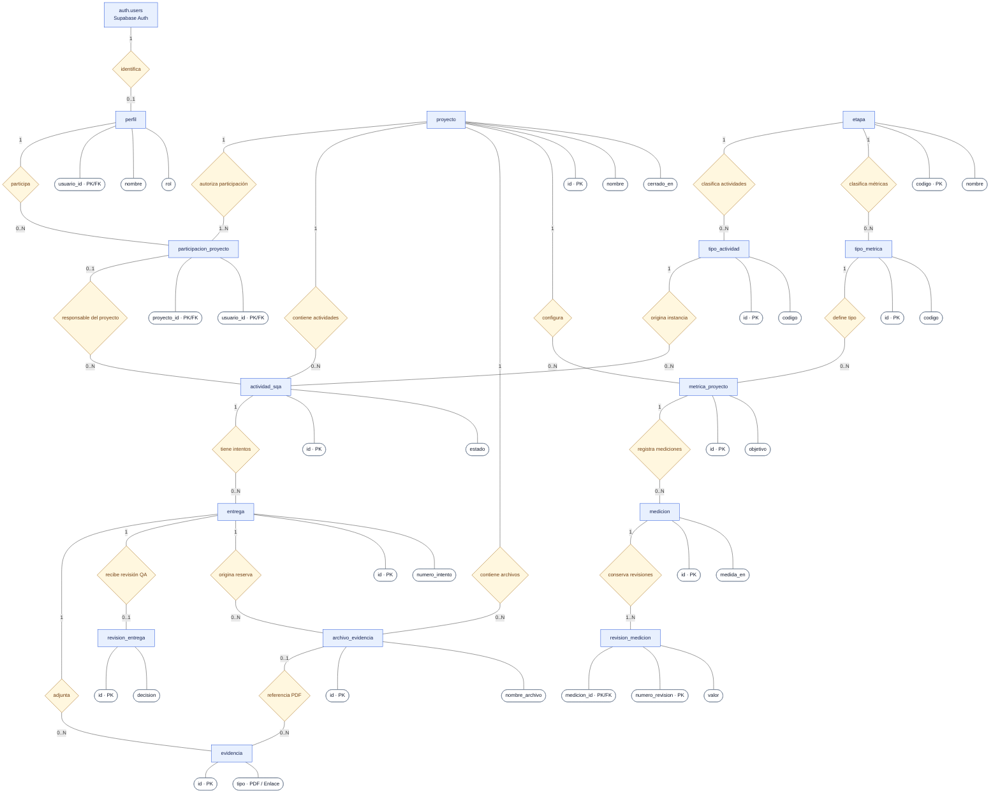

# Modelo entidad–relación — vista Chen simplificada

Vista de las **14 tablas del esquema público** y su vínculo con `auth.users`. Rectángulos = entidades; rombos = relaciones; óvalos = atributos seleccionados. PK identifica la llave primaria. Las entidades conservan los nombres físicos de las migraciones para poder compararlas con PostgreSQL.

Las etiquetas de cardinalidad se leen por extremos: `proyecto — 1 — contiene — 0..N — actividad_sqa` significa que cada actividad pertenece a un proyecto y que un proyecto puede tener ninguna o muchas actividades.

## Reglas que complementan la vista

- `perfil.rol` admite QA o Miembro del equipo. El rol es global; `participacion_proyecto` autoriza acceso al proyecto. No existe una tabla adicional de roles ni un rol diferente por participación.
- La PK de `participacion_proyecto` es `(proyecto_id, usuario_id)`. La asignación usa una FK compuesta hacia esa participación; además se exige rol Miembro. Puede faltar responsable solo mientras la actividad está Pendiente.
- `metrica_proyecto` tiene unicidad `(proyecto_id, tipo_metrica_id)`. En actividades no existe esa unicidad: un tipo puede instanciarse varias veces en el mismo proyecto.
- La etapa de actividades y métricas procede de su catálogo, no de un campo libre en cada instancia. Catálogos y etapas son entidades diferentes.
- Cada proyecto válido incorpora al menos la participación del QA creador mediante la RPC de alta; la cardinalidad mínima no procede de una FK aislada.
- Cada actividad tiene intentos numerados y como máximo un borrador. Una entrega enviada conserva resultado/evidencias; recibe a lo sumo una revisión QA. Una devolución permite crear otro intento.
- Cada evidencia es PDF **o** enlace. Solo PDF tiene `archivo_id`; una evidencia de enlace tiene URL. El archivo físico puede reutilizarse en referencias de varios intentos y mantenerse temporalmente sin referencias por el protocolo de reserva/limpieza.
- Cada medición se crea junto a su revisión inicial; las correcciones anexan revisiones. `revision_medicion` tiene PK `(medicion_id, numero_revision)`.
- Se omiten del dibujo la mayoría de atributos y las relaciones de auditoría con perfil: creador/cierre del proyecto, creador de actividad/medición/archivo, autor de entrega/evidencia/revisión de medición, QA revisor y configurador de objetivos. Sus FK, fechas y versiones permanecen en el esquema y el diccionario. `auth.users` es externa al esquema público; Storage guarda el binario y no aparece como una entidad de negocio adicional.

No hay tablas de puntajes de salud ni histórico de reportes inventados. Esta vista no cambia cardinalidades ni reglas del modelo aprobado; las restricciones condicionales e invariantes se aplican mediante FK, índices, funciones y RLS.

Fuentes: [migración de esquema](../../supabase/migrations/20261018000100_esquema.sql), [ER completo](../datos/modelo-entidad-relacion.md), [diccionario](../datos/diccionario-datos.md) y [seguridad e integridad](../datos/seguridad-integridad.md).
