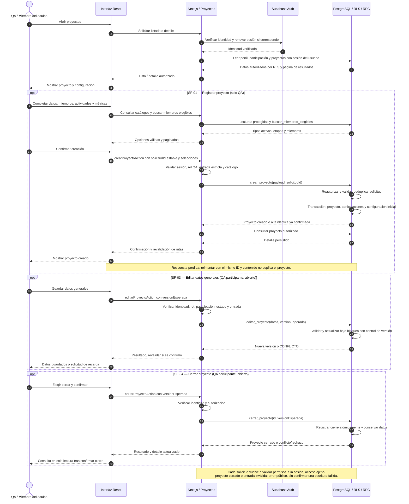

# Secuencia CU-01 — Gestionar proyecto

Actores: QA realiza altas, edición y cierre; QA y Miembro del equipo consultan únicamente proyectos autorizados. Las operaciones de escritura son alternativas disponibles, no pasos obligatorios de una misma ejecución.

SF-02 corresponde al listado/detalle inicial. No se incluye reapertura ni modificación posterior de participantes porque no están aprobadas. La selección inicial no impone mínimos nuevos de actividades o métricas.

Fuentes: [CU-01 implementado](../modulos/cu01-implementacion.md), [acciones](../../src/features/projects/actions.ts) y [consultas](../../src/features/projects/server/queries.ts).
