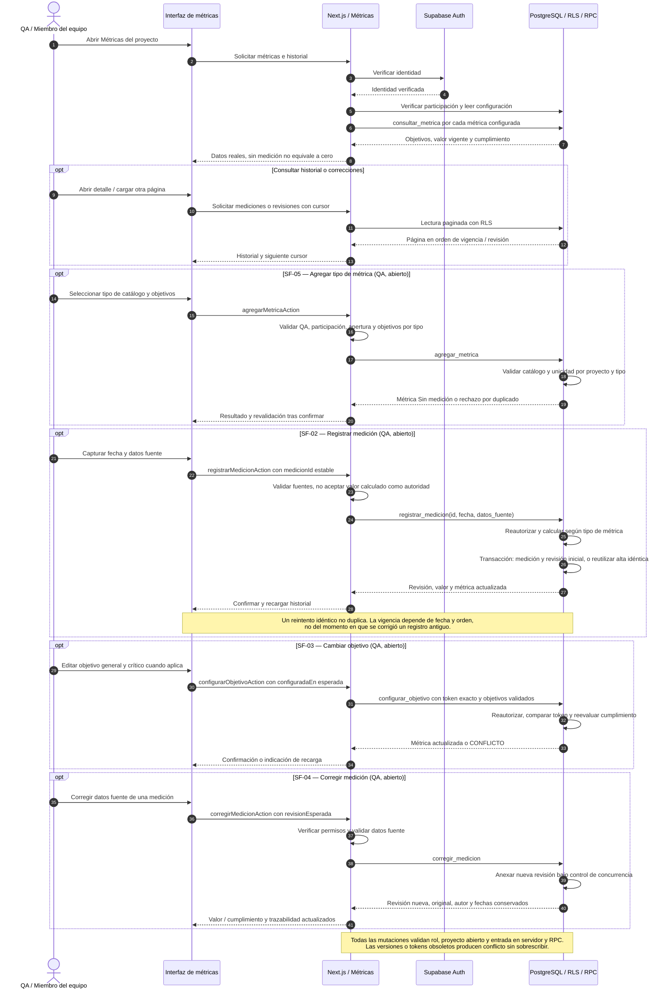

# Secuencia CU-02 — Gestionar métricas de calidad

QA participante gestiona métricas de proyectos abiertos. Miembro del equipo y participantes de proyectos cerrados consultan. El valor persistido y su cumplimiento proceden de la BD; la vista previa no sustituye el cálculo confiable.

SF-01 es la consulta de valor actual e historial. Una medición con denominador cero puede ser No evaluable: no se inventa un cero. Estos cálculos de métricas aprobadas no definen el algoritmo de salud pendiente.

Fuentes: [CU-02 implementado](../modulos/cu02-implementacion.md), [acciones](../../src/features/metrics/actions.ts) y [consultas](../../src/features/metrics/server/queries.ts).
