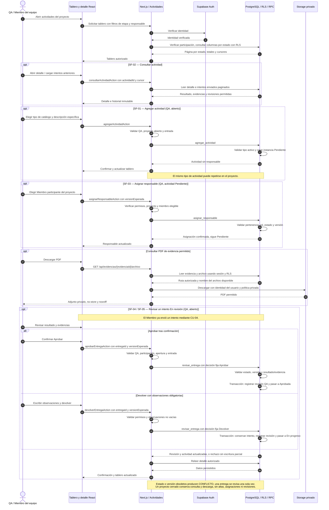

# Secuencia CU-03 — Gestionar actividad SQA

QA participante crea, asigna y revisa en proyectos abiertos. Los participantes autorizados consultan tablero y detalle. El responsable inicia y envía desde CU-04; la asignación no inicia automáticamente la actividad.

Los borradores de entrega del responsable no se exponen como intentos enviados al consultar el detalle de QA. La devolución habilita una corrección mediante un nuevo intento de CU-04; no edita el intento revisado.

Fuentes: [CU-03 implementado](../modulos/cu03-implementacion.md), [acciones](../../src/features/activities/actions.ts) y [descarga](../../src/app/api/evidencias/[evidenciaId]/archivo/route.ts).
