# Secuencia CU-04 — Entregar evidencia de actividad SQA

Solo el Miembro del equipo asignado inicia y prepara su entrega. Adjuntar una evidencia o guardar el resultado no cambia por sí solo la actividad a En revisión. QA decide después mediante CU-03.

```mermaid
sequenceDiagram
    autonumber
    actor M as Miembro del equipo asignado
    participant UI as Mis actividades / Editor React
    participant APP as Next.js / Evidencias
    participant AUTH as Supabase Auth
    participant PDF as Adaptador PDF solo servidor
    participant DB as PostgreSQL / RLS / RPC
    participant ST as Storage privado

    M->>UI: Abrir Mis actividades y seleccionar una actividad
    UI->>APP: Solicitar actividades asignadas e intentos
    APP->>AUTH: Verificar identidad
    AUTH-->>APP: Identidad verificada
    APP->>DB: Leer con responsable igual al usuario y RLS
    DB-->>APP: Actividades, intentos, evidencias y observaciones permitidas
    APP-->>UI: Datos reales del responsable

    alt SF-01 — Actividad Pendiente
        M->>UI: Iniciar actividad
        UI->>APP: iniciarActividadAction con versionEsperada
        APP->>DB: iniciar_actividad con sesión del Miembro
        DB->>DB: Validar asignación y apertura, pasar a En progreso
        DB-->>APP: Nueva versión
        APP->>DB: preparar_entrega con nueva versión
        DB-->>APP: Intento inicial en preparación
    else SF-02 — Actividad devuelta En progreso
        M->>UI: Consultar observaciones y elegir Corregir entrega
        UI->>APP: prepararEntregaAction con versionEsperada
        APP->>DB: preparar_entrega
        DB->>DB: Crear otro intento copiando resultado y referencias previas
        DB-->>APP: Borrador nuevo, intento enviado anterior intacto
    else En progreso con borrador existente
        APP->>DB: Consultar intento en preparación autorizado
        DB-->>APP: Resultado y referencias ya guardados
    end
    APP-->>UI: Actividad y borrador releídos del servidor
    Note over APP,DB: Inicio y preparación son RPC separadas. Si falla preparar tras iniciar,<br/>la actividad puede quedar En progreso y la UI permite preparar el intento después.

    opt Adjuntar enlace
        M->>UI: Introducir URL HTTP/HTTPS válida
        UI->>APP: agregarEnlaceAction con versión esperada
        APP->>APP: Validar URL y permiso de edición
        APP->>DB: agregar_enlace
        DB-->>APP: Referencia confirmada y nueva versión
        APP-->>UI: Evidencia guardada, no se descarga el destino del enlace
    end

    opt Adjuntar un PDF
        M->>UI: Elegir archivo PDF de hasta 3 MiB
        UI->>APP: POST /api/entregas/{entregaId}/evidencias/pdf
        APP->>APP: Validar origen, cabeceras y límite de bytes reales
        APP->>PDF: subirPdf con entrega, versión, nombre y bytes
        PDF->>AUTH: Verificar identidad mediante sesión de servidor
        AUTH-->>PDF: Miembro verificado
        PDF->>PDF: Validar nombre, formato PDF y contenido
        PDF->>DB: Leer entrega y actividad con sesión y RLS
        DB-->>PDF: Autor, responsable y estado autorizados
        PDF->>DB: reservar_archivo con actor verificado y SHA-256
        DB-->>PDF: ID reservado y ruta exclusiva
        PDF->>ST: Subir sin sobrescribir con credencial exclusiva del servidor
        ST-->>PDF: Transferencia terminada
        PDF->>DB: confirmar_archivo con versión esperada
        alt Confirmación satisfactoria
            DB->>DB: Validar y asociar evidencia atómicamente
            DB-->>PDF: Referencia confirmada
            PDF-->>APP: Actividad afectada
            APP->>DB: Releer actividad y evidencias con sesión del usuario
            DB-->>APP: Datos persistidos
            APP-->>UI: Confirmar PDF adjunto y revalidar rutas
        else Rechazo transaccional conocido después de transferir
            DB-->>PDF: Rechazo sin asociación confirmada
            PDF->>DB: marcar_limpieza del archivo de compensación
            DB-->>PDF: Objeto elegible sin referencias
            PDF->>ST: Intentar borrar objeto elegible
            ST-->>PDF: Resultado del borrado
            opt Borrado confirmado
                PDF->>DB: confirmar_eliminacion
            end
            PDF-->>APP: Fallo, no presentar evidencia como adjunta
            APP-->>UI: Error público
        else Confirmación ambigua o respuesta perdida
            DB-->>PDF: Sin confirmación confiable
            PDF-->>APP: Resultado incierto, no borrar inmediatamente
            APP-->>UI: Informar y pedir recargar para comprobar estado real
            Note over PDF,DB: La limpieza posterior respeta referencias y reservas,<br/>no se elimina un archivo que pudiera haber quedado confirmado.
        end
    end

    M->>UI: Completar resultado y elegir Enviar a revisión
    opt Resultado modificado
        UI->>APP: guardarResultadoAction con versionEsperada
        APP->>DB: guardar_resultado
        DB-->>APP: Resultado persistido y nueva versión
        APP-->>UI: Borrador actualizado
    end
    UI->>APP: enviarEntregaAction con versión actual
    APP->>DB: Leer resultado y cantidad de evidencias autorizadas
    DB-->>APP: Datos para indicar faltantes
    alt Falta resultado o evidencia
        APP-->>UI: Indicar elementos obligatorios, no enviar
    else Entrega completa
        APP->>DB: enviar_entrega
        DB->>DB: Revalidar permisos, estado y versión, envío atómico
        DB->>DB: Fijar enviada_en y pasar actividad a En revisión
        DB-->>APP: Intento enviado inmutable
        APP->>DB: Releer actividad autorizada
        DB-->>APP: Datos confirmados
        APP-->>UI: Confirmar envío y mostrar solo lectura
    end
    Note over UI,DB: Tras una devolución de CU-03 se prepara otro intento, sin sobrescribir el anterior.<br/>Proyecto cerrado: consulta y descarga permitidas, preparación y envío bloqueados.
```

La descarga de PDF usa el flujo privado mostrado en [CU-03](secuencia-CU-03.md), también disponible al responsable. Las lecturas/escrituras ordinarias conservan identidad del usuario; solo las RPC técnicas y la subida validada de PDF usan la credencial administrativa aislada.

El diagrama detalla fallos de confirmación tras la transferencia; un rechazo conocido durante la subida también puede activar compensación. Ante fallos ambiguos no se borra inmediatamente. Si se pierde la respuesta HTTP después de guardar, recargar recupera el estado real antes de decidir otro intento de subida.

**Límite actual:** Mis actividades e intentos de CU-04 todavía no están paginados, a diferencia del tablero e historial de QA de CU-03.

Fuentes: [CU-04 implementado](../modulos/cu04-implementacion.md), [acciones](../../src/features/evidences/actions.ts), [adaptador PDF](../../src/features/evidences/server/archivos.ts) y [handler de subida](../../src/app/api/entregas/[entregaId]/evidencias/pdf/route.ts).
